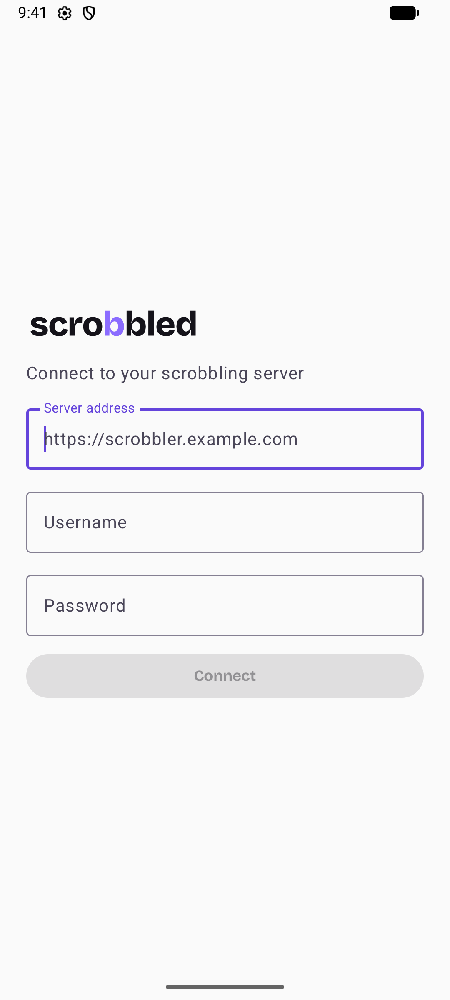
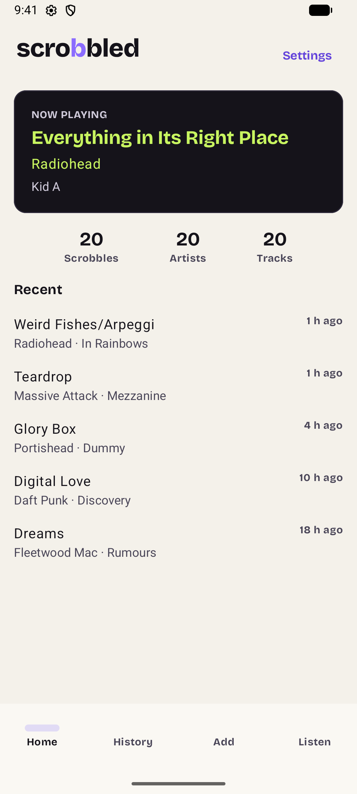
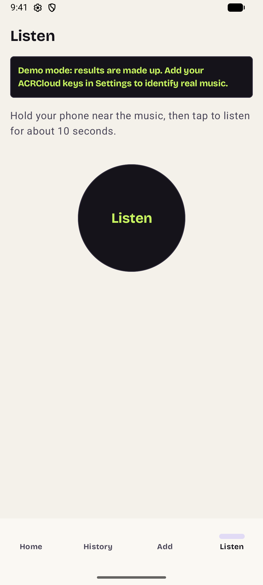
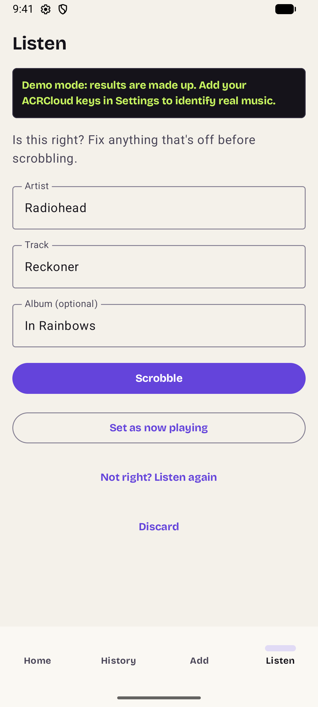
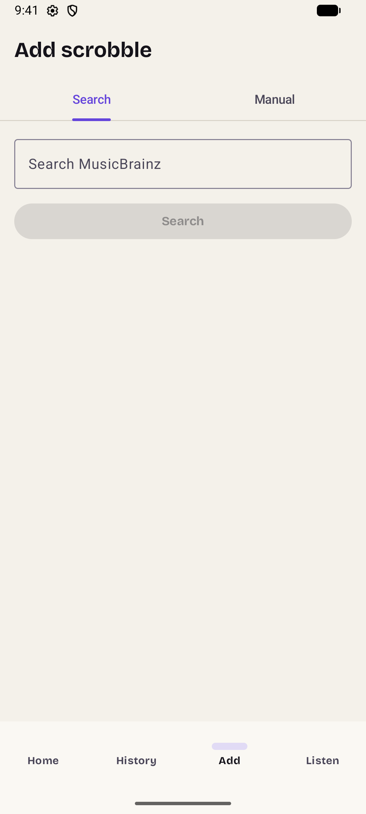
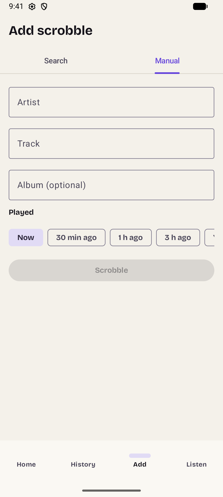
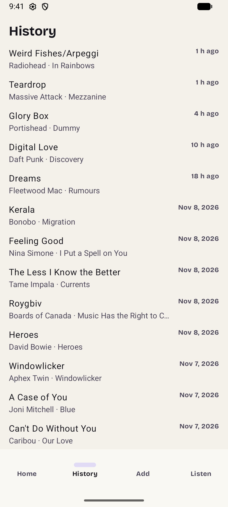
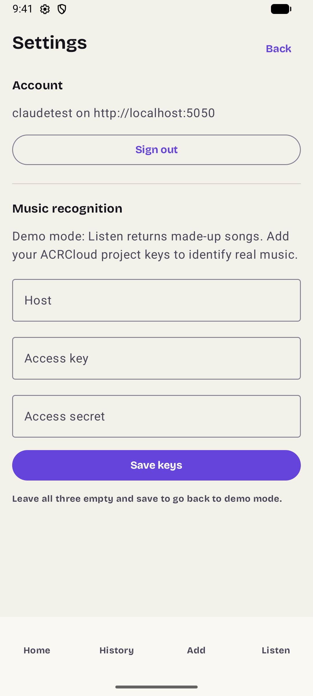

# Scrobbled user guide

Scrobbled is an Android app for your own scrobbling server
([ScrobblingService](https://git.daubney.dev/matt/Scrobbler)). It records what you listen to, lets you
add plays by hand, and shows your history. It works with any Last.fm-compatible server that exposes
the same API.

This guide shows the light theme. The app follows your phone's light/dark setting, and
[dark-theme screenshots](screenshots/dark/) of every screen are in the repository too.

**Contents**
[Before you start](#before-you-start) ·
[Connect to your server](#connect-to-your-server) ·
[Home](#home) ·
[Listen](#listen-identify-a-song) ·
[Add a scrobble](#add-a-scrobble) ·
[History](#history) ·
[Settings](#settings) ·
[When you're offline](#when-youre-offline) ·
[Troubleshooting](#troubleshooting)

## Before you start

You need:

- An Android phone or tablet running Android 10 or newer.
- A scrobbling server with an account on it. Scrobbled doesn't create accounts.
- *Optional:* a free [ACRCloud](https://www.acrcloud.com) account if you want **Listen** to
  recognise real music. Setup steps are in the [README](../README.md#setting-up-acrcloud-music-recognition).

## Connect to your server

The first time you open the app you see the Connect screen.

1. **Server address**: the full address of your server, for example `https://scrobbler.example.com`.
2. **Username** and **Password**: your account on that server.
3. Tap **Connect**.

Scrobbled signs in, registers itself on your account as an app called "Scrobbled Android", and
remembers the connection. Your password is not stored on the phone.

If your login expires (after about 30 days) you're returned to this screen with the server and
username filled in. Scrobbles you haven't sent yet are kept and sent once you sign in again.

 

## Home

Home is a summary of your listening:

- **Now playing** shows the track your server currently has as playing. It reads **Nothing
  playing** when nothing is active.
- **Scrobbles, Artists, Tracks** are your totals.
- **Recent** lists your latest scrobbles with how long ago each was played.
- A banner reading **"N scrobbles waiting to send"** appears if some haven't reached the server yet
  (see [When you're offline](#when-youre-offline)).

Use the bar along the bottom to switch between **Home**, **History**, **Add** and **Listen**.
**Settings** is the button at the top right of Home.

 

## Listen: identify a song

Listen identifies music playing near you.

1. Open the **Listen** tab.
2. Hold your phone near the music and tap **Listen**. The first time, Android asks for permission
   to use the microphone. Scrobbled uses it only while you are listening.
3. Wait about 10 seconds while it records and then identifies the song. You can tap **Cancel**
   while it's listening.

> **Demo mode.** Until you add ACRCloud keys, the dark banner at the top says results are made up.
> Listen will still work, but it returns sample songs instead of identifying real music. See
> [Settings](#settings) to add your keys.

 

When a song is found, check it before it's recorded. You can edit the **Artist**, **Track** and
**Album** if something's off, then choose:

- **Scrobble**: save it as a play. It's recorded with the time you started listening.
- **Set as now playing**: show it as now playing without adding it to your history.
- **Not right? Listen again**: throw the result away and try once more.
- **Discard**: throw the result away and go back to the start.

If nothing is recognised you'll see "Couldn't identify that. Try again, closer to the speaker." with a
**Try again** button.

 

## Add a scrobble

Use **Add** for plays Scrobbled didn't hear: something you listened to on another device, for
example.

### Search

1. Open **Add**, then the **Search** tab.
2. Type an artist and/or track into **Search MusicBrainz** and tap **Search**.
3. Tap the matching result. Its details are filled in on the **Manual** tab, marked
   "Matched on MusicBrainz".
4. Choose when you played it and tap **Scrobble** (see below).

If nothing matches you'll see "No matches. Try fewer words, or add it manually."

 

### Manual

1. Open the **Manual** tab.
2. Enter the **Artist** and **Track**. **Album** is optional.
3. Under **Played**, choose when you listened: **Now**, **30 min ago**, **1 h ago**, **3 h ago**
   and so on. Scroll the row sideways to see more options.
4. Tap **Scrobble**.

The server ignores plays older than 14 days.

 

## History

**History** lists every scrobble from newest to oldest. Recent plays show how long ago they were
played ("4 h ago") and older ones show a date. Scroll down to load more. If loading fails, tap
**Retry**.

 

## Settings

Open Settings from the top right of **Home**. Tap **Back** to return.

**Account** shows who you're signed in as and where. **Sign out** ends the session and returns to
Connect. If you have scrobbles that haven't been sent yet, Scrobbled asks first: choose
**Stay signed in** to keep them, or **Discard and sign out** to delete them.

**Music recognition** is where you add your ACRCloud details so Listen can identify real music:

| Field | What to enter |
|---|---|
| **Host** | The host of your ACRCloud project, for example `identify-eu-west-1.acrcloud.com` |
| **Access key** | Your project's access key |
| **Access secret** | Your project's access secret (hidden as you type) |

Tap **Save keys**. The line above the fields then reads "Listen uses ACRCloud." To go back to demo
mode, clear all three fields and save. Keys are encrypted on the phone and never sent anywhere
except to ACRCloud. See the [README](../README.md#setting-up-acrcloud-music-recognition) for how to
create the project.

 

## When you're offline

If a scrobble can't be sent (no signal, or your server is down), Scrobbled keeps it on your phone
and tries again automatically when the connection comes back, oldest first. Home shows how many are
waiting. You don't need to do anything.

## Troubleshooting

| Problem | Try this |
|---|---|
| Connect fails | Check the address includes `https://` (or `http://` for a server on your own network) and that your phone can reach it. |
| You're sent back to Connect | Your login expired. Sign in again; unsent scrobbles are kept. |
| Listen says results are made up | You're in demo mode. Add your ACRCloud keys in Settings. |
| Listen can't hear anything | Allow microphone access for Scrobbled in Android's app settings, and move closer to the music. |
| A scrobble is missing from History | It may still be waiting to send, so check for the banner on Home. Plays older than 14 days are dropped by the server. |

More technical help is in the [README](../README.md#troubleshooting).
